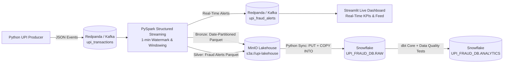

# Real-Time UPI Fraud Detection Lakehouse

An end-to-end streaming data engineering and analytics pipeline that simulates live UPI transactions, detects fraudulent activity in real time using stateful windowing, persists raw and flagged events to a local S3-compatible Lakehouse, and delivers tested Gold-tier analytics in Snowflake via dbt.

---

## Architecture



---

## Tech Stack

| Layer | Technology |
| :--- | :--- |
| **Event Streaming** | Redpanda (Kafka API-compatible), Redpanda Console |
| **Stream Processing** | Apache Spark (PySpark Structured Streaming) |
| **Object Storage / Lakehouse** | MinIO (S3-compatible), Apache Parquet |
| **Real-Time Visualization** | Streamlit, Pandas, Confluent Kafka Python |
| **Cloud Data Warehouse** | Snowflake (`PUT` + `COPY INTO` internal stages) |
| **Analytics & Transformation** | dbt Core (`dbt-snowflake`) |
| **Infrastructure** | Docker Compose, Python 3.12 |

---

## Real-Time Fraud Detection Rules

PySpark processes incoming transactions in **1-minute tumbling event-time windows** (with a 1-minute watermark for late-arriving data) grouped by `user_id`:

1. **`VELOCITY_BURST`** — 5 or more transactions by the same user within 1 minute.
2. **`HIGH_VALUE_ANOMALY`** — Any single transaction exceeding ₹50,000.
3. **`IMPOSSIBLE_TRAVEL`** — Transactions from 2 or more distinct cities by the same user within 1 minute.

---

## Verified Pipeline Metrics

Sample output from `UPI_FRAUD_DB.ANALYTICS.GOLD_DAILY_FRAUD_SUMMARY`:

| Date | Total Txns | Total Volume (INR) | Total Fraud Alerts | Flagged Volume (INR) | Velocity | High-Value | Impossible Travel |
| :--- | ---: | ---: | ---: | ---: | ---: | ---: | ---: |
| `2026-11-24` | 10,687 | ₹5,78,28,544.88 | 1,659 | ₹3,64,45,754.37 | 309 | 252 | 1,098 |
| `2026-11-23` | 11,463 | ₹5,82,42,681.51 | 1,570 | ₹3,36,69,141.45 | 347 | 210 | 1,013 |

---

## Project Structure

```text
upi-fraud-lakehouse/
├── docker-compose.yml              # Redpanda, Redpanda Console, MinIO, Spark
├── src/
│   ├── producer/
│   │   └── upi_generator.py        # Simulated UPI transaction stream producer
│   ├── streaming/
│   │   └── fraud_detector.py       # PySpark Structured Streaming & fraud rules
│   ├── dashboard/
│   │   └── app.py                  # Live Streamlit fraud monitoring app
│   └── warehouse/
│       └── load_to_snowflake.py    # MinIO Parquet -> Snowflake RAW loader
├── dbt_upi_fraud/
│   └── models/
│       ├── sources.yml             # Snowflake RAW source definitions
│       ├── schema.yml              # not_null & unique data quality tests
│       ├── gold_daily_fraud_summary.sql
│       └── gold_high_risk_users.sql
└── .gitignore
```

---

## Quick Start

### 1. Start Local Infrastructure
```bash
docker compose up -d
```
* **Redpanda Console:** `http://localhost:8085`
* **MinIO Console:** `http://localhost:9001` (Create bucket `upi-lakehouse`)

### 2. Start the Producer & PySpark Streaming Job
```bash
# Terminal 1: Start UPI event producer
python src/producer/upi_generator.py

# Terminal 2: Submit PySpark Structured Streaming job
docker compose exec spark /opt/spark/bin/spark-submit \
  --conf spark.jars.ivy=/tmp/.ivy2 \
  --packages org.apache.spark:spark-sql-kafka-0-10_2.12:3.5.3,org.apache.hadoop:hadoop-aws:3.3.4 \
  /opt/spark/work-dir/src/streaming/fraud_detector.py
```

### 3. Launch the Real-Time Dashboard
```bash
# Terminal 3: Streamlit monitor (http://localhost:8501)
streamlit run src/dashboard/app.py
```

### 4. Sync Lakehouse to Snowflake & Run dbt Gold Models
Configure your Snowflake credentials in a local `.env` file (`SNOWFLAKE_ACCOUNT`, `SNOWFLAKE_USER`, `SNOWFLAKE_PASSWORD`, `SNOWFLAKE_ROLE`, `SNOWFLAKE_WAREHOUSE`, `SNOWFLAKE_DATABASE`, `SNOWFLAKE_SCHEMA`), then run:

```bash
# Load Bronze & Silver Parquet files from MinIO into Snowflake RAW
python src/warehouse/load_to_snowflake.py

# Build & test Gold analytics tables
cd dbt_upi_fraud
dbt run
dbt test
```